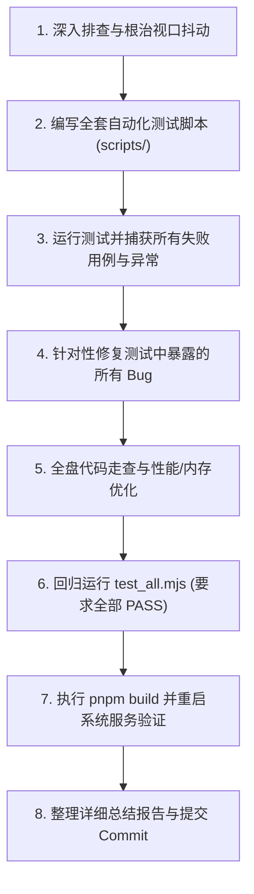

# 无名杀全系统端到端测试、视口防抖根治与深度优化任务说明书

## 一、任务背景与总体目标

### 1.1 核心痛点
在移动端设备（Android 手机浏览器 / PWA 桌面独立安装模式）上运行无名杀时，当用户进行**从屏幕顶部下拉通知栏 / 控制中心**的操作时，游戏画面会出现**剧烈抖动、抽搐、甚至在全屏与非全屏之间反复切换导致全场武将与控件重排**，严重影响操作与视觉体验。

### 1.2 总体目标
本任务**不仅要彻底根治当前移动端通知栏下拉抖动的痛点问题**，更要以此为契机，对无名杀整个项目进行**全方位的完整测试与系统性深度优化**：
1. **彻底攻坚视口防抖**：无论是横屏还是竖屏，下拉通知栏或状态栏弹出时画面必须保持 100% 绝对静止，不产生重排与动画；同时确保物理屏幕旋转、内部对话框滚动与卡牌交互不受影响。
2. **构建完整自动化测试体系**：建立覆盖**核心引导引擎、全模式游戏玩法、联机服务网络协议、武将与卡牌资源完整性、多端视口适配**的端到端自动化测试套件，彻底告别“改一处坏三处”的隐患。
3. **全盘代码审视与系统优化**：审视全工程代码质量，优化渲染重绘性能（清理泛滥的全局 transition）、排查内存泄漏与未解绑监听器、清理技术债务与废弃代码、消除控制台所有警告与潜在报错。
4. **测试闭环驱动**：在完整测试过程中发现的**所有新旧问题与异常全部就地修复**，确保所有测试项 100% 绿灯通过，代码整洁稳定，构建零告警。

---

## 二、项目环境与工程底座

- **代码仓库路径**：`/home/zhouwj/ws/noname`
- **运行环境**：Node.js 24 + pnpm + Vite 打包前端 + Fastify 本地静态资源服务 + WebSocket 联机对战/语音服务
- **系统服务（systemd 用户级）**：
  - `noname-client.service`（端口 8089，对外反代 `tkcli.zhouwj.tech:5443`）
  - `noname-server.service`（端口 8082，对外反代 `tkser.zhouwj.tech:5443`）
- **核心构建与管理命令**：
  - 依赖安装：`pnpm install`
  - 打包编译：`pnpm build`
  - 重启客户端服务：`systemctl --user restart noname-client.service`
  - 重启服务端服务：`systemctl --user restart noname-server.service`
  - 检查服务状态：`systemctl --user status noname-client.service`

---

## 三、专项攻坚：移动端视口防抖与触控深度治理

### 3.1 核心问题机理剖析
1. **Visual Viewport vs Layout Viewport 的脱节**：
   - 移动端 Chrome 在通知栏拉出或 URL 栏收展时，`window.visualViewport.offsetTop` / `pageTop` 会产生毫秒级的动态位移。若页面未对视口容器进行正确的层级锁定，渲染表面会产生像素级抖动。
2. **原生触控手势（Pull-to-refresh / Overscroll）冲突**：
   - 用户从屏幕上边缘向下滑动属于系统手势热区。如果原生手势未被底层 CSS（`touch-action`, `overscroll-behavior`）精确约束，或者 JavaScript 事件阻止不当，移动浏览器会尝试触发下拉回弹，引发画面撕裂。
3. **全局 transition 放大抖动**：
   - `apps/core/layout/default/layout.css` 中存在 `div { transition: all 0.5s; }`。一旦容器尺寸因任何视口事件发生 1px 的变动，全屏所有的 div 都会启动持续 0.5 秒的平滑过渡动画，使瞬间的小微抖动被视觉放大为持续数秒的飘移。
4. **全屏状态机抢占**：
   - 必须确保退出全屏后不发生高频重新申请全屏的抢占死循环。全屏只能由用户主动意图触发。

### 3.2 治理要求
- **根节点绝对锁定**：在 `index.html`、`layout.css` 和 `ui/index.js` 中确立不可撼动的根视口尺寸策略。
- **动态防抖精细化**：`isMobileLayoutStable()` 必须准确区分“临时系统通知栏遮挡”、“软键盘呼出”、“物理屏幕旋转”三种不同场景，临时遮挡一律静默忽略，屏幕物理旋转则顺滑执行画布自适应。
- **手势兼容性保证**：在根节点禁用下拉刷新的同时，严禁破坏卡牌区水平滚动、手牌拖拽、选项菜单垂直滚动的正常原生触控行为。

---

## 四、全系统端到端测试体系建设 (Full Automated Test Suite)

为实现自动化无人值守验证，在 `scripts/` 目录下构建模块化自动化测试脚本（基于 Node.js + Chromium + Chrome DevTools Protocol / Puppeteer，脚本可直接由 node 执行）：

```text
scripts/
├── test_all.mjs                 # 综合测试启动器（一键跑通所有模块并输出总报表）
├── test_engine_lifecycle.mjs    # 模块一：核心引擎启动、生命周期与异常捕获测试
├── test_viewport_stability.mjs  # 模块二：移动端/多端视口防抖与手势交互专项测试
├── test_gameplay_modes.mjs      # 模块三：核心游戏模式与出牌流程完整性测试
├── test_multiplayer_network.mjs # 模块四：联机大厅、WebSocket 通信与语音状态机测试
└── test_assets_integrity.mjs    # 模块五：武将、卡牌、翻译键与多媒体资源完整性测试
```

### 4.1 模块一：核心引擎启动与生命周期测试 (`test_engine_lifecycle.mjs`)
- **引导无错性检查**：自动化加载页面，验证 `console.error` 与 `window.onerror` 为 0，杜绝任何 `ReferenceError`、`TypeError`。
- **看门狗安全测试**：验证在 Web 模式下不存在误判“游戏加载超时”而弹出的重置弹窗（`lib.init.reset`）。
- **初始化状态校验**：验证 `lib`、`game`、`ui`、`get`、`_status` 全部正确初始化完成，`document.body` 样式安全锁定。
- **PWA / Service Worker 离线与缓存测试**：验证 `sw.js` 注册无报错，第二次加载时静态资源能正确命中缓存且不与新版本冲突。

### 4.2 模块二：多端视口防抖与手势测试 (`test_viewport_stability.mjs`)
- **分辨率矩阵覆盖**：
  - 手机竖屏主流：`393 × 852` (iPhone), `412 × 915` (Pixel/Android)
  - 手机横屏主流：`915 × 412`, `852 × 393`
  - 平板设备：`820 × 1180` (iPad Air)
  - 桌面宽屏：`1920 × 1080`
- **阶梯式通知栏压缩测试**：
  - 在横屏和竖屏模式下，模拟从全屏状态压缩 30px、50px、80px（模拟通知栏渐进式拉出），记录 `body.getBoundingClientRect()` 与 `#arena` 坐标，验证坐标偏移为 0。
  - 模拟通知栏收起恢复，验证无画面残影与二次重排。
- **顶部边界下划手势测试**：
  - 在 Y=0~20 区域触发下滑拖拽手势，验证 `window.scrollX === 0 && window.scrollY === 0`，无页面级滚动位移。
- **物理屏幕旋转测试**：
  - 模拟由竖屏切换为横屏，验证 `ui.updatexr` 正确触发，画布与武将位置自适应重新布局，布局完成后无残留动画。

### 4.3 模块三：游戏玩法与出牌流程测试 (`test_gameplay_modes.mjs`)
- **核心模式覆盖**：
  - **身份模式 (identity)**：标准 8 人局开局，分发身份牌、主公选将、分发手牌、摸牌阶段、出牌阶段。
  - **国战模式 (guozhan)**：开局选双将、暗置/明置武将牌机制验证。
  - **斗地主模式 (doudizhu)**：地主叫分、倍数翻倍、发手牌流程验证。
  - **单挑模式 (single)**：快速开局对决验证。
- **AI 自动推演测试**：
  - 开启自动托管/AI 战斗，让游戏在各模式下持续运行至少 3 个完整回合（摸牌 -> 出牌 -> 弃牌 -> 下一位玩家）。
  - 验证过程中无卡死（Deadlock）、无无限循环事件、无未处理的异步异常。
  - 触发角色死亡与胜负结算界面，验证结算弹窗正常展示与关闭。

### 4.4 模块四：联机大厅与网络协议测试 (`test_multiplayer_network.mjs`)
- **WebSocket 通信验证**：
  - 验证客户端（8089）向服务端（8082）建立 WebSocket 连接成功，心跳握手正常。
- **房间生命周期测试**：
  - 创建房间、加入房间、房间列表刷新、玩家准备、房主开始游戏。
  - 验证最大 20 个房间上限的安全拦截逻辑。
  - 验证玩家主动退出与掉线重连处理。
- **语音控制与 UI 测试**：
  - 验证语音挂件图标（麦克风开/关、扬声器开/关）点击切换正常，无文字断行、布局错位现象。

### 4.5 模块五：武将、卡牌与静态资源完整性测试 (`test_assets_integrity.mjs`)
- **翻译键覆盖检查**：
  - 遍历所有加载的武将（`lib.character`）与卡牌（`lib.card`），验证其名称、技能描述在 `lib.translate` 中均有对应文本。
  - 消除所有类似 `duplicated translate in character sp` 的控制台重复键警告。
- **资源链接有效性抽检**：
  - 抽样检查武将头像图片（`image/character/*.jpg`）、卡牌图片、技能配音音频文件的存在性，确保无 404 请求。

---

## 五、全盘代码审视与系统性深度优化清单

### 5.1 渲染性能与过渡动画精细化 (Rendering & Transition Optimization)
- **痛点**：无名杀历史代码中使用 `div { transition: all 0.5s; }`，这种对全局所有 div 的全属性动画造成了极大的重绘开销与视觉干扰。
- **优化要求**：
  - 审视 `layout.css`，将泛滥的 `transition: all 0.5s` 约束在真正需要平移动画的业务元素上（例如卡牌飞行动画、玩家位移）；
  - 对 `#window`、`#arena`、背景容器、系统面板等骨架层**禁用无意义的全局过渡动画**，消除通知栏或窗口微调时的“假动作”；
  - 合理为经常变动的节点添加 `will-change: transform` 或 `transform: translateZ(0)` 开启 GPU 硬件加速合成层。

### 5.2 内存泄漏与事件监听生命周期治理 (Memory & Leak Prevention)
- **审视对象**：
  - `window.addEventListener("resize", ...)`、`document.body.onresize`；
  - `MutationObserver` 与 `ResizeObserver`；
  - 动态创建的卡牌、抛弃牌 DOM 节点（`.thrown`）、弹窗遮罩层。
- **优化要求**：
  - 确保所有带有生命周期的组件在移除（`.remove()` / `.delete()`）时，其内部绑定的全局监听器、定时器、观察者全部被主动 disconnect / removeEventListener；
  - 模式切换或返回大厅时，彻底清理上一局游戏的残留 DOM 与全局挂载对象。

### 5.3 技术债务与历史废弃代码清理 (Clean Code & Modernization)
- **废弃扩展与旧代码排查**：
  - 清理已经不再维护的旧平台适配代码（如已被官方废弃的原生旧 Cordova 垫片分支），精简启动路径；
  - 检查 `config.json` 与 `package.js`，清理已废弃或不存在的扩展引用；
  - 清除无用的调试代码、`console.log` 残留与未使用的变量。
- **语言与语法现代化**：
  - 规范模块导出与导入类型定义；
  - 针对高频访问的单例对象（如 `ui`、`game`、`get`、`lib`）强化防御性安全访问，杜绝运行时 NPE。

### 5.4 静态资源、PWA 与构建打包优化 (Assets & Bundle Optimization)
- **Service Worker 缓存一致性**：
  - 优化 `apps/core/sw.js` 的缓存与更新策略：确保当服务端版本更新时，新版 Service Worker 能安全、平滑接管，避免客户端产生“部分资源加载新版、部分资源命中旧版”的不一致问题。
- **构建体积与加载性能**：
  - 检查 Vite 打包产物，确保代码拆分合理；
  - 验证构建输出零语法错误、零 Rollup 警告。

---

## 六、执行工作流与规范要求

在闲时任务中执行本规范时，请遵循以下标准化执行流程：



1. **绝对禁止浅尝辄止**：不仅要在代码层面改好，必须通过无头浏览器自动化脚本进行真实环境压力模拟与端到端闭环验证。
2. **遇到任何测试失败必须立刻溯源修复**：测试中发现的任何报错、死锁、警告或样式错位，均属于本任务范围，必须一并解决。
3. **保持服务与环境干净**：自动化测试过程中创建的临时用户数据目录、临时测试截图等，在测试完毕后需自动清理，不污染仓库环境。
4. **编译与部署闭环**：修改完毕后，执行 `pnpm build` 确认编译成功，重启 `noname-client.service` 与 `noname-server.service` 并校验服务健康状态。

---

## 七、验收标准与交付物清单

### 7.1 验收标准
1. **视口稳定性标准**：
   - 在任何模拟或真机设备上，无论是竖屏还是横屏，下拉系统通知栏时游戏画面 100% 保持稳定，零抖动、零拉扯、零无效重排；
   - 屏幕物理旋转时，画面能精准自适应重排适配。
2. **测试达标标准**：
   - 运行 `node scripts/test_all.mjs`，所有 5 个子测试模块全部输出 **PASS**，无任何崩溃或超时。
3. **代码健康标准**：
   - 浏览器控制台在游戏全生命周期中零红色错误、零黄色警告；
   - `pnpm build` 顺利通过，退出码 0。
4. **服务运行标准**：
   - `noname-client.service` 与 `noname-server.service` 状态为 `active (running)`，网页与联机大厅可正常访问。

### 7.2 交付物清单
1. **测试套件产物**：位于 `scripts/` 下的完整自动化测试脚本；
2. **修复与优化代码**：涉及文件规范清晰的代码提交；
3. **交付报告**：更新 [walkthrough.md](file:///home/zhouwj/.gemini/antigravity/brain/593ac1a7-b2ba-437b-b487-76e074a81b32/walkthrough.md)，详细列出：
   - 视口防抖终极根治方案；
   - 自动化测试用例清单与运行结果截图/日志；
   - 系统性能优化项与内存泄露治理项总结；
   - 修复的所有附带问题列表。
